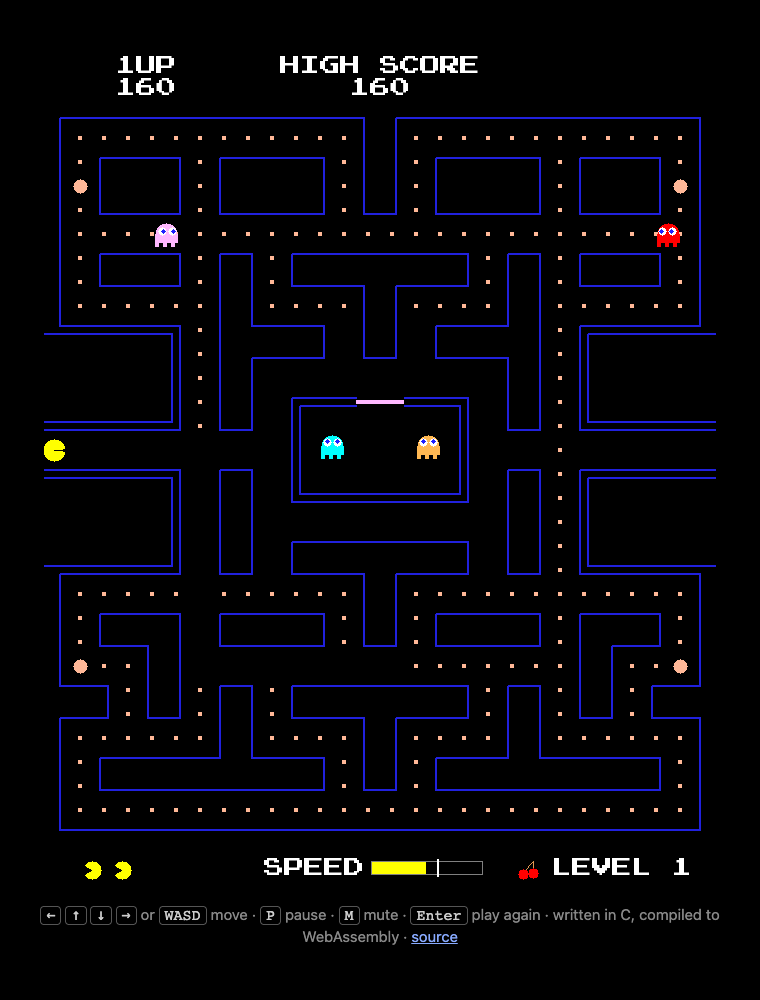

# pacman-c

Pac-Man in C with SDL2.


## Features

- The classic 28×31 maze with pellets, power pellets and the side tunnels
- Four ghosts with their arcade personalities: Blinky chases you, Pinky ambushes ahead of you, Inky flanks with Blinky and Clyde loses interest up close
- Scatter and chase waves, frightened ghosts after a power pellet, and eyes that run back to the ghost house
- Fruit, an extra life at 10,000 points, levels that speed up, and a saved high score
- Our own twist on the arcade: every pellet makes Pac-Man a little faster for good (up to +50%, kept across levels, lost when he dies) and gives him a short burst of speed that fades in half a second. A speed gauge at the bottom shows it, and past 110% speed he leaves a faint trail
- Arcade-style sound synthesized in code, with no audio files: intro jingle, waka-waka, siren, ghost and death sounds

## Controls

| Key | Action |
|---|---|
| Arrows or WASD | Move |
| P | Pause |
| M | Mute |
| Enter or Space | Play again after game over |
| Esc | Quit |

## Build and play

You need a C compiler, SDL2 and SDL2_ttf.

macOS (Homebrew):

```sh
brew install sdl2 sdl2_ttf
```

Debian/Ubuntu:

```sh
sudo apt install build-essential libsdl2-dev libsdl2-ttf-dev
```

Then:

```sh
make run      # build and play
make          # just build ./pacman
make test     # run the automated test
make clean    # remove the binaries and the web build
```

`./run.sh` does the same as `make run`.

The game loads `font.ttf` from the folder it runs in. The high score is saved in SDL's per-user preferences folder (on macOS, `~/Library/Application Support/gubatron/pacman-c/highscore.txt`).

## Play in a browser

Play it online at **https://gubatron.com/pacman-c/**.



The same C code compiles to WebAssembly with [Emscripten](https://emscripten.org). Install it first:

```sh
brew install emscripten       # macOS
```

On Linux, install the [emsdk](https://emscripten.org/docs/getting_started/downloads.html) and run `source ./emsdk_env.sh` so `emcc` is on your `PATH`. Emscripten downloads and compiles its own SDL2 and SDL2_ttf the first time you build, so that build takes a few minutes.

Then:

```sh
make web      # builds build/web/: index.html, index.js, index.wasm, index.data
make serve    # builds it and serves it at http://localhost:8000
```

Open the page through a web server like `make serve`, not by double-clicking `index.html`: browsers won't load the `.wasm` and `.data` files from a `file://` page.

To put it on a website, upload the four files in `build/web/` to a folder on the server, for example:

```sh
scp build/web/index.* user@example.com:/var/www/example.com/pacman-c/
```

Then open `https://example.com/pacman-c/`. Nothing runs on the server; any static web server works, as long as it sends `.wasm` files as `application/wasm` (nginx, Apache and Caddy do by default).

Browsers only play sound after the visitor clicks or presses a key, so the page starts the game on the first one. In the browser the high score is kept in the site's `localStorage`. The page itself is [`web/shell.html`](web/shell.html).

## Headless test

`make test` builds a test version of the game and lets a bot play 200,000 frames (about 55 minutes of play) without a window or sound. After every frame it checks things that must always be true, such as nobody standing inside a wall, and every 5000 frames it clears the board to exercise the level transitions. It prints `OK ...` or the first problem it found.

To choose the number of frames or save the last frame as an image, run the test binary yourself:

```sh
make pacman-test
SDL_VIDEODRIVER=dummy SDL_AUDIODRIVER=dummy PACMAN_FRAMES=50000 PACMAN_SHOT=shot.bmp ./pacman-test
```

## Reading the code

This game is meant to be read: every file starts with what it does and why, and the comments explain both how Pac-Man works and the C techniques used along the way (header guards, `static` for private data, `extern`, designated initializers, passing results through pointers, sharing data with an audio thread).

Each module is a `.h` file, its public interface, plus a `.c` file with the implementation. A good reading order:

| File | What it covers |
|---|---|
| [`src/main.c`](src/main.c) | Startup, the fixed time step main loop, keyboard input, shutdown |
| [`src/config.h`](src/config.h) | The shared numbers: maze size, frame rate, speeds, landmarks |
| [`src/maze.h`](src/maze.h), [`src/maze.c`](src/maze.c) | The level layout, directions, tile geometry, walls and the tunnel |
| [`src/game.h`](src/game.h), [`src/game.c`](src/game.c) | The game state, the state machine, scoring, lives, levels, fruit, collisions |
| [`src/player.h`](src/player.h), [`src/player.c`](src/player.c) | Pac-Man's pixel-by-pixel movement, buffered turns and eating |
| [`src/ghosts.h`](src/ghosts.h), [`src/ghosts.c`](src/ghosts.c) | The ghost AI: target tiles, the four personalities, scatter/chase, fright, the ghost house |
| [`src/render.h`](src/render.h), [`src/render.c`](src/render.c) | Drawing the maze outlines, characters and text with SDL |
| [`src/sound.h`](src/sound.h), [`src/sound.c`](src/sound.c) | A small synthesizer: waves, envelopes, mixing, and the audio thread |
| [`src/highscore.h`](src/highscore.h), [`src/highscore.c`](src/highscore.c) | Saving the high score |
| [`src/soak_test.h`](src/soak_test.h), [`src/soak_test.c`](src/soak_test.c) | The automated test |
